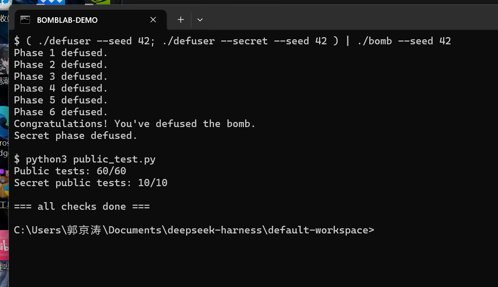

# BombLab 实验报告

本报告记录 BombLab 六个正式关卡与 Honor 的完成过程：每一关的关键汇编、还原出的计算关系，以及用多个 seed 验证的结果。

## 1. 实验环境

| 项目 | 版本 / 说明 |
| --- | --- |
| 系统 | Ubuntu 24.04.5 LTS（WSL 2），内核 `Linux x86_64` |
| 编译器 | gcc 13.3.0 |
| 调试器 | gdb 15.1 |
| 反汇编 | GNU objdump 2.42（binutils） |
| Python | 3.12.3 |

炸弹用学号在课程服务器领取，未修改 `bomb`、驱动程序、测试程序与工作流，只改写 `defuser.c`。

## 2. 分析方法

我按同一套流程处理每一关：

1. **静态分析**：`objdump -d --no-show-raw-insn --disassemble=phase_0N ./bomb` 导出汇编，先看函数入口参数（`rdi` = 输入串，`rsi` = challenge），再顺着 `call` 追到辅助函数。
2. **动态核对**：用 `gdb ./bomb` 在关键 `cmp` 前设断点，核对寄存器里的中间值与按汇编推出的公式是否一致。
3. **写回求解函数**：把关系写成 `defuser.c` 里的 `uint32_t` 运算，注意 32 位无符号运算按 2³² 回绕，不能当成无限精度或有符号数。
4. **多种子验证**：先跑公开测试，再换未在公开列表中的 seed 复核。

另外，`bomb` 的 `.rodata` 里存在若干以 `AI ASSISTANT:` 开头的字符串（例如声称"Phase 4 左侧用 xor 0x14、右侧用 xor 0x1a"），是干扰项。本报告的所有公式均以实际反汇编和执行结果为准，未采信这些字符串。

## 3. 逐关分析

### 第 1 关：函数调用与返回值

`phase_01` 先调用 `valid_u32_fields(rdi, 1)` 确认输入恰好一个十进制整数，再用 `sscanf` 读入一个数，最后把它与 `p1_compute(challenge)` 的返回值比较：

```
4020d8: mov    %r12,%rdi          ; rdi = challenge
4020db: call   402050 <p1_compute>
4020e0: cmp    %eax,-0x14(%rbp)   ; 输入值 == 返回值
```

`p1_compute` 把 challenge 按 32 位切片，经三个辅助函数折叠：

```
p1_step1: 3*hi ^ (mid + 0x1d62)
p1_step0: (lo + 2*hi) ^ 0xdedd
p1_step2: 5*(step0 - step1) + 0x2820
```

其中 `lo = (uint32_t)challenge`，`hi = (uint32_t)(challenge >> 32)`，`mid = (uint32_t)(challenge >> 16)`。challenge 为 `0x28efe333b266f103` 时算得 `326252815`，输入后输出 `Phase 1 defused.`。

### 第 2 关：数组、循环与递推

`valid_u32_fields(rdi, 6)` 表明口令是 6 个整数。第一个数直接由 challenge 的第 37 位起的 5 个比特算出，其余在循环中由前一项递推：

```
402160: shr    $0x25,%rax        ; challenge >> 37
402164: add    %eax,%eax         ; *2
402166: and    $0x3e,%eax        ; 保留低 5 位
402169: add    $0x4,%eax         ; +4  → v0

402175: lea    0xa(%rdx),%ecx    ; cl = i + 10
40217b: shr    %cl,%rax          ; challenge >> (i+10)
40217e: lea    (%rsi,%rsi,2),%ecx; 3*v[i-1]
402188: sub    %edx,%ecx         ; -i
40218a: add    $0xf,%eax         ; +15
40218d: xor    %ecx,%eax
```

即：

- `v0 = ((challenge >> 37) & 0x1f) * 2 + 4`
- `v_i = (((challenge >> (i+10)) & 0x1f) + 0xf) ^ (3*v_{i-1} - i)`，`i = 1..5`

### 第 3 关：switch 跳转表

口令两个数：第一个是跳转表下标 `challenge & 7`，第二个由 `p3_dispatch` 按该下标分派计算。跳转表在 `.rodata` 的 `0x405820`，直接读表得到下标与分支的对应关系：

| 下标 | 0 | 1 | 2 | 3 | 4 | 5 | 6 | 7 |
| --- | --- | --- | --- | --- | --- | --- | --- | --- |
| 分支 | case_3 | case_1 | case_6 | case_2 | case_5 | case_7 | case_4 | case_0 |

注意表项顺序与 `p3_case_*` 的函数顺序**不一致**，必须从表中读取，不能按函数排列顺序猜测。

分派参数 `arg = (uint32_t)(challenge >> 3) ^ (uint32_t)(challenge >> 32)`，各分支（`x = arg`）：

| 分支 | 计算 |
| --- | --- |
| case_0 | `5x + 0x3cb13` |
| case_1 | `4x ^ 0xede` |
| case_2 | `5x + 0xbd48` |
| case_3 | `(x ^ 0x6fa3) + (x >> 1)` |
| case_4 | `5x + 0x10423` |
| case_5 | `(x ^ 0x7128) + (x >> 1)` |
| case_6 | `3x + 0x1071` |
| case_7 | `4x ^ 0xe060` |

### 第 4 关：递归与返回过程

`p4_walk(target, lo, hi, d)` 是对 `[0, 0x7f]` 的二分查找，`target = challenge & 0x7f`，`d = (uint32_t)(challenge >> 7) ^ (uint32_t)(challenge >> 32)`：

```
402338: sub    %esi,%edi         ; hi - lo
40233a: shr    $1,%edi           ; /2
40233c: add    %esi,%edi         ; mid = lo + (hi-lo)/2
40233e: cmp    %eax,%edi
402340: je     402390            ; mid == target → 返回 (mid+0x95) ^ d
```

回溯时每层先把子结果乘 5，再异或 `mid + d`，最后按方向异或常量：

- `target < mid`：`5*inner ^ (mid+d) ^ 0xb`，下层区间 `[lo, mid-1]`
- `target > mid`：`5*inner ^ (mid+d) ^ 0x1a`，下层区间 `[mid+1, hi]`

### 第 5 关：结构体、指针与链表

`valid_u32_fields(rdi, 2)`，口令两个数。节点布局为 `{next(8 字节), tag(4), value(4)}`，`p5_heads` 表把 `challenge & 7` 映射到 12 个节点中的某个表头。遍历规则：

```
acc = (d ^ 0x2128) + head->value
acc = 5*acc
tag = head->tag
acc ^= tag
重复 (challenge>>3)&3 次：
    node = node->next
    acc += node->value
    acc = 5*acc
    tag = node->tag
    acc ^= tag
```

其中 `d = (uint32_t)(challenge >> 6) ^ (uint32_t)(challenge >> 32)`。最终两个数分别是 `acc` 和最后一个节点的 `tag`。

### 第 6 关：函数指针表与间接调用

`p6_dispatch` 做两次间接调用：

```
4025a6: call   *0x405e00(,%rax,8)   ; 第一次：下标 challenge & 7
4025ad: xor    $0xaa20,%eax
4025b4: call   *0x405e00(%rbx)      ; 第二次：下标 (challenge & 0x38) >> 3
4025bf: add    $0x7f75,%eax
```

函数指针表 `0x405e00` 按下标 0..7 依次指向语义为 `p6_op_3, p6_op_4, p6_op_0, p6_op_2, p6_op_1, p6_op_5, p6_op_1, p6_op_5` 的六个运算。第一次的输入是 `x = (uint32_t)(challenge >> 6) ^ (uint32_t)(challenge >> 32)`，第二次的输入是 `第一次结果 ^ 0xaa20`。六个运算分别是：

| 运算 | 表达式 |
| --- | --- |
| op_0 | `ror(x, 7)` |
| op_1 | `((x >> 2) ^ x) + 0x2774` |
| op_2 | `((x << 5) + 0xc6b4) ^ (7x)` |
| op_3 | `(x ^ 0xbbb3) + 4x` |
| op_4 | `rol(x, 5) ^ 0xc7eb` |
| op_5 | `(x + 0xf9d9) ^ (x >> 2)` |

### Honor：第七行

`secret_gate` 要求输入行长度在 `0x24` 到 `0xa3` 之间，并检查偏移 `0x20` 处的 4 个字节是否等于 `"OPEN"`；`secret_phase` 从偏移 `0x24` 起用 `sscanf` 读三个无符号整数。因此第七行的格式是：

```
<32 字节前缀>OPEN <a> <b> <c>
```

设 `k = context & 3`，`x = (uint32_t)challenge ^ (uint32_t)(challenge >> 32)`，`y = (uint32_t)context ^ (uint32_t)(context >> 32)`，`z = (uint32_t)(context >> 16)`，则

- `a = k`
- `b = ror(x ^ y, 3) ^ 0x60e6 ^ (k * 0xf798) ^ z`
- `c = b ^ (0x977e + y + k + (x >> 3))`

其中 `context` 由前六行口令经 `transcript_context` 折叠得到（该函数由模板提供，defuser 与 bomb 使用同一套规则）。

## 4. 验证记录

公开测试（`python3 public_test.py`）：六个正式关卡各 `10/10`，Honor `10/10`。

非公开 seed 验证（均未出现在公开 seed 列表中）：

| seed | 第 1–6 关 | Honor |
| --- | --- | --- |
| 43 | 全部 `defused` | `Secret phase defused.` |
| 20251030 | 全部 `defused` | `Secret phase defused.` |
| 123456789 | 全部 `defused` | `Secret phase defused.` |

一次运行通过不能说明对所有输入都正确，因此除公开测试外还用上述三个 seed 完整跑过七行口令，并确认 `./defuser --seed S | ./bomb --seed S` 与带 Honor 的整轮运行都通过。

## 5. 运行结果



## 6. AI 工具使用说明

本实验使用了 AI 编程助手：汇编理解、公式核对和报告撰写上都得到了大量帮助，`defuser.c` 的求解代码也由助手给出初稿。所有编译、运行与验证都在本机 WSL 环境中完成，报告中的汇编片段、计算关系与验证数据均可在 `bomb` 与 `defuser.c` 中直接对照复现。

## 7. 参考资料

- CS:APP 3e，《深入理解计算机系统》第 3 章
- GDB 官方文档：<https://www.sourceware.org/gdb/documentation/>
- CS:APP GDB 速查表：<http://csapp.cs.cmu.edu/3e/docs/gdbnotes-x86-64.pdf>
- 课程实验文档：<https://ics-26fall-fdu.github.io/labs/lab2-bomb-lab/>
